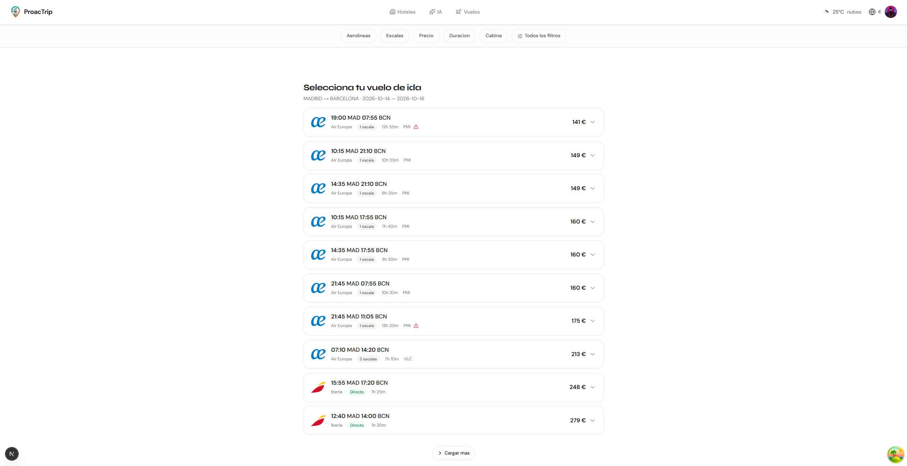
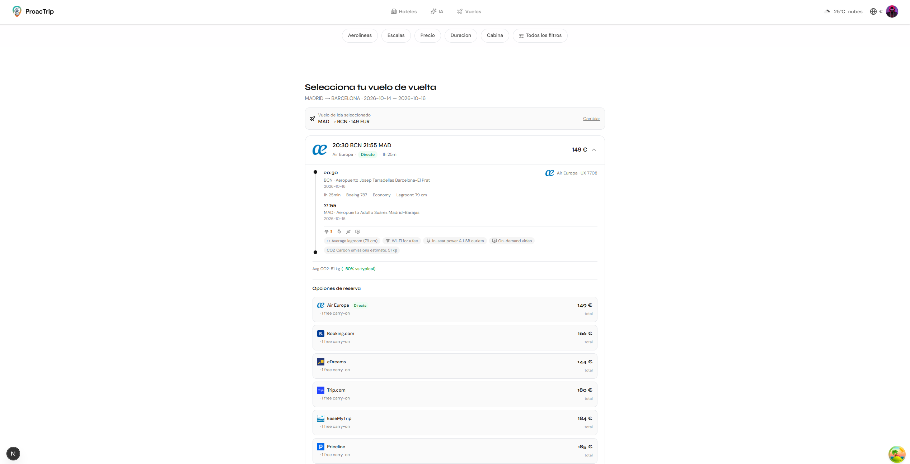
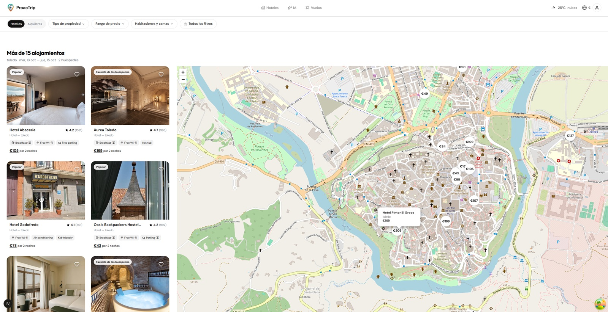

# ProacTrip Frontend

[](https://nextjs.org/)
[](https://react.dev/)
[](https://www.typescriptlang.org/)
[](https://tailwindcss.com/)
[](https://tanstack.com/query)
[](https://leafletjs.com/)

Interfaz web de **ProacTrip**, una plataforma de viajes: búsqueda de vuelos y hoteles, mapa con precios, clima y ubicación del visitante, gestión de cuenta, panel de administración y búsqueda asistida por IA.

Este repositorio contiene solo el **frontend**. El backend (API en Go) está en otro repositorio: [ProacTrip/Backend](https://github.com/ProacTrip/Backend).

> **Demo en vivo:** pendiente de desplegar. Mientras tanto, mira las capturas de abajo.

---

## Capturas

| Inicio | Vuelos |
| :---: | :---: |
|  |  |

| Detalle de vuelo | Hoteles con mapa |
| :---: | :---: |
|  |  |

| Inicio de sesión |
| :---: |
|  |

---

## Tecnologías

| Área                   | Tecnología                                  | Versión |
| ---------------------- | ------------------------------------------- | ------- |
| **Framework**          | Next.js (App Router, Turbopack)             | 16      |
| **UI**                 | React                                       | 19      |
| **Lenguaje**           | TypeScript                                  | 5       |
| **Estilos**            | Tailwind CSS                                | 4       |
| **Datos del servidor** | TanStack Query                              | 5       |
| **Animaciones**        | Framer Motion y dotLottie                   | 12      |
| **Componentes**        | Headless UI                                 | 2       |
| **Mapas**              | Leaflet y react-leaflet (OpenStreetMap)     | 1.9 / 5 |
| **Iconos**             | lucide-react y react-icons                  | —       |

---

## Qué incluye

| Módulo               | Descripción                                                                                  | Estado             |
| -------------------- | -------------------------------------------------------------------------------------------- | ------------------ |
| **Vuelos**           | Búsqueda por origen, destino y fechas, filtros y detalle con opciones de reserva             | Funciona           |
| **Hoteles**          | Búsqueda con filtros, mapa con precios y ficha del hotel                                     | Funciona           |
| **Cuenta**           | Registro, login, verificación de correo, perfil, preferencias y documentos                   | Funciona           |
| **Entorno**          | Idioma, moneda, ubicación y clima del visitante                                              | Funciona           |
| **Tiempo real**      | Eventos del servidor mediante SSE                                                            | Funciona           |
| **Administración**   | Gestión de usuarios y documentos                                                             | Funciona           |
| **Búsqueda con IA**  | Chat que interpreta una petición en lenguaje natural                                         | Requiere IA en el backend (desactivada en la demo) |
| **Checkout y compras** | Flujo de reserva y pago                                                                    | En desarrollo (maqueta) |
| **Favoritos**        | Lista de favoritos                                                                           | En desarrollo (solo en el navegador) |

---

## Arquitectura

```
src/
├── app/
│   ├── (site)/        # Páginas con barra de navegación
│   │   ├── vuelos/    #   búsqueda y detalle de vuelos
│   │   ├── hoteles/   #   búsqueda, mapa y ficha de hotel
│   │   ├── busqueda-ai/
│   │   ├── perfil/  documentos/  favoritos/
│   │   └── checkout/  compras/  confirmacion/  contacto/
│   ├── auth/          # Login, registro, verificación y recuperación
│   ├── admin/         # Panel de administración (usuarios, documentos)
│   ├── api/           # Rutas de servidor de Next.js (proxy de imágenes)
│   └── lib/           # Cliente de la API, tipos, constantes y utilidades
├── components/        # Componentes por dominio: navbar, home, auth, admin, ui, shared
├── contexts/          # Sesión y moneda
├── hooks/             # Hooks de TanStack Query (perfil, documentos, SSE...)
└── proxy.ts           # Protege rutas privadas según las cookies de sesión
public/                # Imágenes, animaciones y recursos estáticos
docs/screenshots/      # Capturas usadas en este README
```

---

## Cómo se conecta con el backend

```
Navegador  ──►  Next.js (localhost:3000)
                   │
                   │  fetch(..., { credentials: 'include' })
                   ▼
            API en Go (localhost:8080)
            ├── /v1/auth         registro, login, sesión
            ├── /v1/search       vuelos, hoteles, IA
            ├── /v1/user         perfil, documentos, favoritos
            ├── /v1/environment  ubicación, clima, moneda
            ├── /v1/dashboard    administración
            └── /v1/realtime     eventos SSE
```

- **Sesión:** cookies `HttpOnly` con tokens PASETO. El frontend nunca ve ni guarda los tokens; el navegador los envía solo.
- **Rutas privadas:** `proxy.ts` redirige a `/auth/login` si no hay sesión en `/perfil`, `/documentos`, `/favoritos`, `/compras`, `/checkout`, `/confirmacion` y `/admin`. La autorización real la decide el backend.
- **Errores:** el cliente de la API traduce las respuestas de error del backend (RFC 9457) a mensajes en español y avisa cuando se supera el límite de peticiones.
- **Búsquedas públicas:** vuelos, hoteles y búsqueda con IA no exigen iniciar sesión.

---

## Puesta en marcha

### Requisitos

- Node.js 20.9 o superior.
- El backend de ProacTrip en marcha, por defecto en `http://localhost:8080` (instrucciones en su repositorio).

### Pasos

```bash
git clone https://github.com/marcos32143/proactrip-frontend.git
cd proactrip-frontend
npm install
cp .env.example .env.local     # en Windows CMD: copy .env.example .env.local
npm run dev
```

Abre <http://localhost:3000>.

### Variables de entorno

Se definen en `.env.local`, que no se sube a git.

| Variable                             | Obligatoria | Descripción                                                                              |
| ------------------------------------ | :---------: | ---------------------------------------------------------------------------------------- |
| `NEXT_PUBLIC_API_URL`                | Sí          | URL del backend, por ejemplo `http://localhost:8080`                                     |
| `NEXT_PUBLIC_FEATURE_PASSWORD_RESET` | No          | `true` activa la recuperación de contraseña en la interfaz                               |
| `NEXT_PUBLIC_SIMULATE_IP`            | No          | Solo desarrollo: IP pública enviada en `X-Real-IP` para probar la ubicación en local     |

Las variables con prefijo `NEXT_PUBLIC_` son visibles en el navegador: no pongas en ellas claves ni secretos.

### Scripts

| Comando             | Qué hace                                  |
| ------------------- | ----------------------------------------- |
| `npm run dev`       | Servidor de desarrollo con recarga        |
| `npm run build`     | Compilación de producción                 |
| `npm start`         | Sirve la compilación de producción        |
| `npm run lint`      | Revisa el código con ESLint               |
| `npm run typecheck` | Comprueba los tipos de TypeScript         |

---

## Despliegue

Pensado para Vercel. En producción hay que definir `NEXT_PUBLIC_API_URL` con la URL pública del backend (por ejemplo `https://api.tudominio.com`). Para que las cookies de sesión funcionen, la web y la API deben compartir dominio (`tudominio.com` y `api.tudominio.com`).

---

## Créditos

- **Frontend:** Marcos Casas.
- **Backend:** Marco Aurelio, en [ProacTrip/Backend](https://github.com/ProacTrip/Backend).
